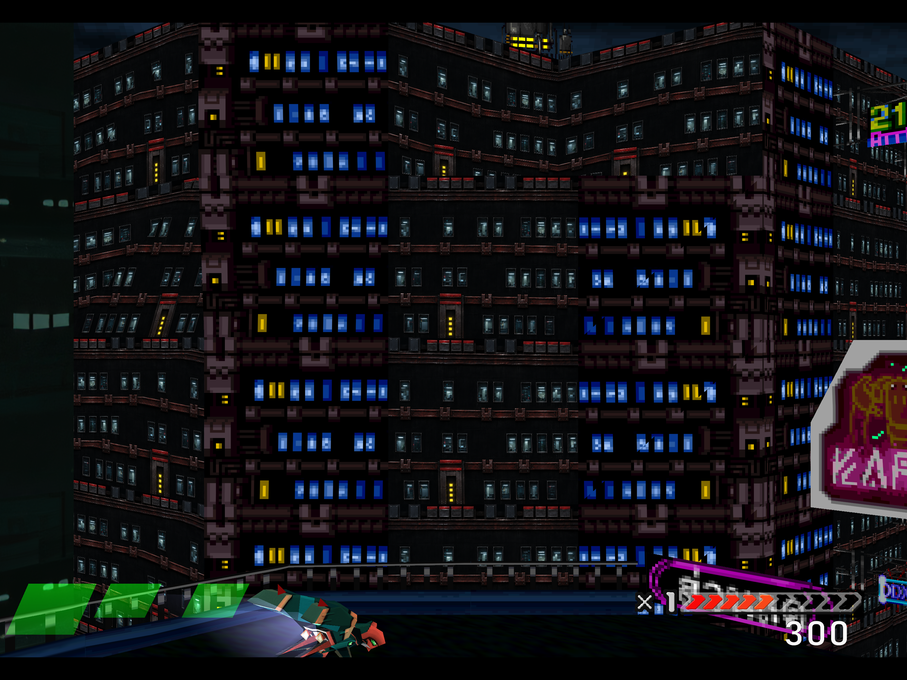
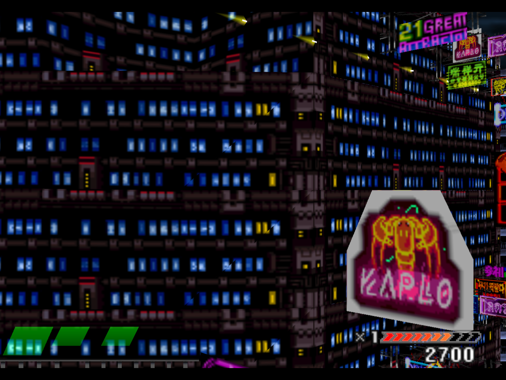
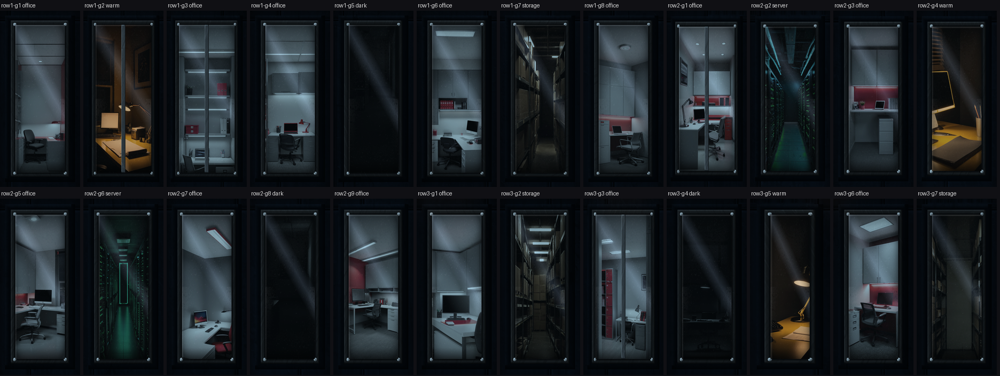
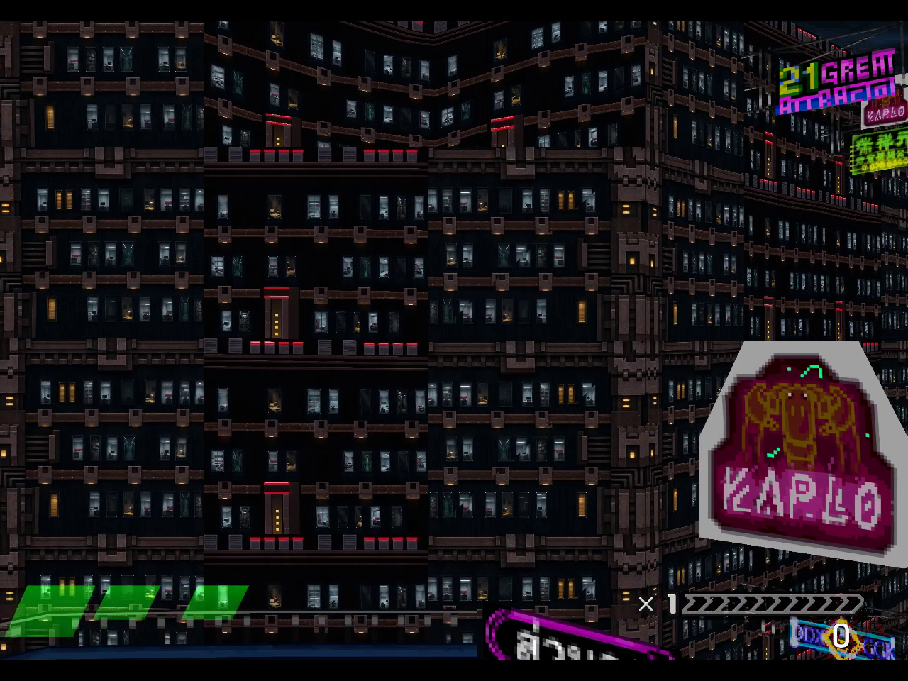
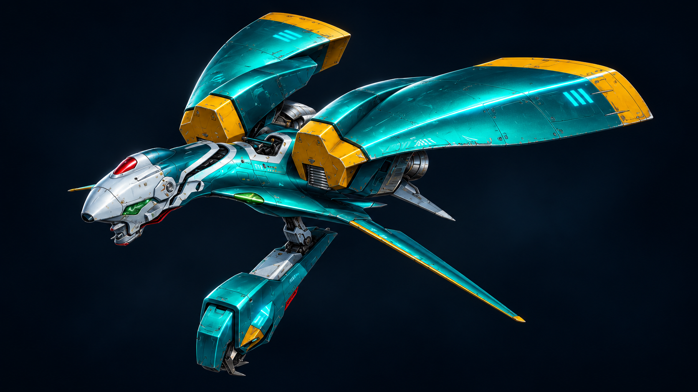
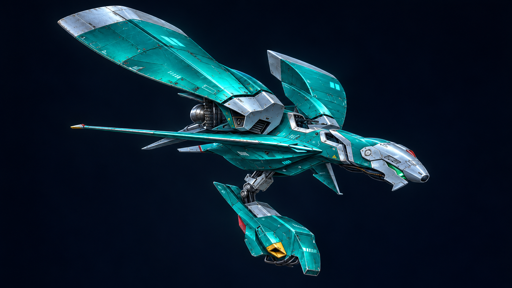
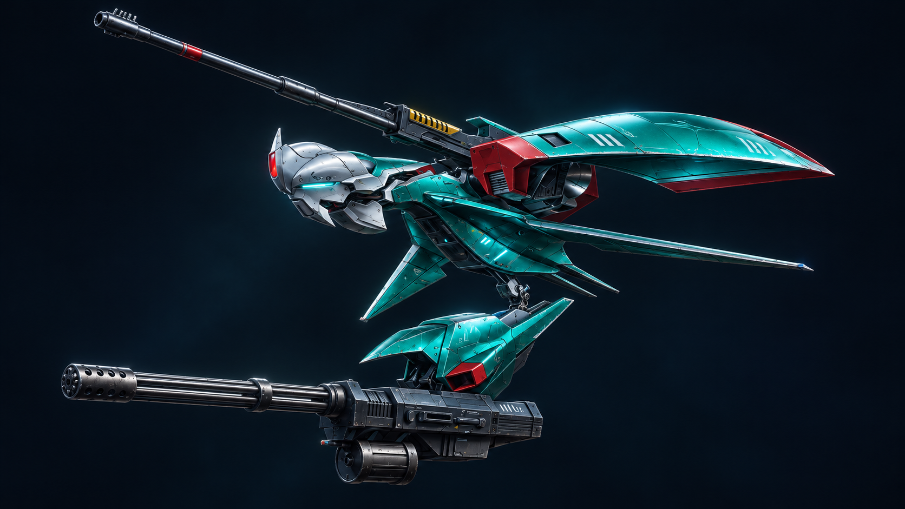
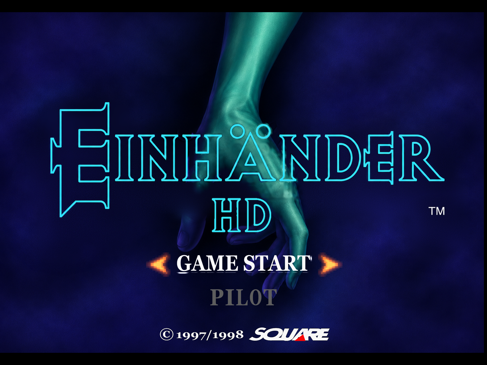
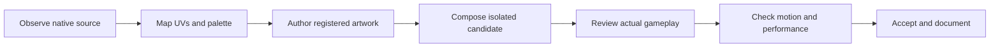

<div align="center">

# EINHÄNDER HD

**A modern restoration of a dark industrial world.**

Source-aware textures · photographic material studies · 2160p game captures

[Gallery](docs/GALLERY.md) · [Comparisons](docs/COMPARISONS.md) · [Developer guide](docs/DEVELOPMENT.md) · [Restoration plan](remaster-audit/REMASTER_COMPLETION_PLAN.md)


<a href="docs/media/gallery/einhander-hd-dark-city.png"></a>

<sub>Actual 2880 × 2160 internal game capture. The mapped facade is a verified pilot; neighboring surfaces are still being restored.</sub>

</div>

## The direction

Keep Einhänder's dark silhouettes, saturated windows and industrial character. Rebuild the detail where it matters: recessed glass, visible rooms, worn steel, readable signs and controlled light. Judge the result while flying past buildings at different angles and distances.

This repository contains the modified recompilation sources, authoring tools and verification workflow. The restoration is in active development. Whole-game coverage, frame pacing and audio continuity remain open work.

## Stock · DuckStation · Einhänder HD

<table>
<tr><th width="33%">Native textures</th><th width="33%">DuckStation + HD textures</th><th width="33%">Our restoration</th></tr>
<tr>
<td><a href="docs/media/gallery/stock-native-city.png"></a></td>
<td><a href="https://www.youtube.com/watch?v=vpgemmHly3Q"></a></td>
<td><a href="docs/media/gallery/einhander-hd-dark-city.png"></a></td>
</tr>
<tr>
<td><strong>Original texture appearance</strong><br>HD replacement disabled; 4× rendering in the recompiled runtime.</td>
<td><strong>Independent reference</strong><br>NoBigDeal La's video; textures credited to IceBullet. Click to watch.</td>
<td><strong>Mapped material replacement</strong><br>Dark walls, glass, room interiors and worn steel; 2160p internal capture.</td>
</tr>
</table>

These are different runs and viewpoints. The middle panel links to the original reference video. Settings, attribution and comparison limits are recorded in [Comparison notes](docs/COMPARISONS.md).

## Architecture and windows

The new facade master contains **24 photographic rooms**: 13 offices, three storage rooms, two server rooms, three dark after-hours rooms and three warm desk-lamp rooms. Each room is cropped to its glass opening and scaled uniformly. Glass, reflections, contact dirt and the dark building mass are composed separately.

<a href="docs/media/gallery/h24-windows-review.png"></a>

<sub>Artwork review sheet. Asset preparation and in-game acceptance are tracked separately.</sub>

**Matched building, November 12, 2026:** the remaining blue-window strips now use photographic rooms, dark glass and rust-brown framing alongside the original 24-room facade. The fresh normal-speed game recording shows both mappings on front and angled faces. The original H24 artwork is unchanged.

[](https://github.com/Ghenghis/Einhander-HD/raw/refs/heads/main/docs/media/gallery/h24-matched-fly-past.mp4)

[Watch the new 46-second fly-past](https://github.com/Ghenghis/Einhander-HD/raw/refs/heads/main/docs/media/gallery/h24-matched-fly-past.mp4) · [Actual results, evidence and earlier footage](docs/H24-IN-GAME-RESULTS.md)

<sub>Assisted private visual test: no firing; normal speed with turbo and rewind off; bounded timer aid disclosed. Silent 1280 × 960 video, clear close view around 14 seconds. Natural occlusion remains. New neighbor artwork is 1254 × 1254, packed at 4096 × 4096. Performance and whole-level acceptance remain open.</sub>

The tile is bound to verified native source words, palette and UV coordinates. The formerly blue neighbor strip uses a distinct tile and now has a separately registered matching layout. The current inventory contains 324 palette keys across ten mixed atlas families; these do not count buildings or establish complete environment coverage.

## Ships, Gunpods and materials

The art collection includes **16 identity-specific equipment studies** and **14 finish concepts**, exploring silhouettes, armor finishes, mechanical detail and Gunpod treatments grounded in reference material.

<table><tr>
<td width="33%"><br><strong>Endymion FRS Mk. II</strong></td>
<td width="33%"><br><strong>Endymion FRS Mk. III</strong></td>
<td width="33%"><br><strong>Astraea FGA Mk. I</strong></td>
</tr></table>

<sub>Generated concept artwork. These illustrations are not installed UV textures or proof of illustrated runtime geometry.</sub>

The runtime also supports source-allowlisted player/enemy color treatments and subtle RGB detail layers. Their live verification is distinct from the concept collection. [Explore all equipment, finishes and materials →](docs/GALLERY.md)

## Title, menus and HUD

Title composition, typography, diagrams, Results screens and palette-sensitive UI assets have dedicated source maps and isolated integration checks.

<a href="docs/media/gallery/title-e-in-game.png"></a>

<sub>Actual internal capture of the E title layout. Further UI coverage and cosmetic cleanup remain in progress.</sub>

## A traceable restoration pipeline



The tools provide native source registration, immutable candidate packs, private test cards, hash-checked composition, observed UI/gameplay gates, renderer captures and source/draw receipts. A default-off facade sampling experiment adds RGB mipmaps, trilinear filtering and supported anisotropy while preserving categorical PSX transparency.

High image dimensions alone are not acceptance. The original 4:3 scene currently has a 2880 × 2160 internal surface. Some art inputs have smaller native dimensions; measured sizes and roles are retained in [gallery provenance](docs/media/gallery/provenance.json).

## Development

```sh
git clone https://github.com/Ghenghis/Einhander-HD.git
cd Einhander-HD
```

The active integration is under [windows-x64](windows-x64/). [macos-arm64](macos-arm64/) preserves a separate source snapshot; current parity and a clean-checkout build remain unverified.

Supply your own original game data and local configuration. Disc images, retail BIOS, memory cards, generated game/BIOS C, model weights and complete replacement packs are not included. Start with the [developer guide](docs/DEVELOPMENT.md) and included [framework build instructions](windows-x64/psxrecomp/docs/BUILDING.md).

## Current priorities

- Finish photographic facade integration and expand building, sign and background-layer coverage.
- Measure and improve gameplay hitches, audio continuity, streaming and frame pacing.
- Verify window readability, seams, repeated placements and palette changes in normal scrolling.
- Map equipment concepts to runtime surfaces and cover remaining UI states.
- Complete stage, boss, weapon, effect and end-state coverage before a full-remaster release.

The [completion plan](remaster-audit/REMASTER_COMPLETION_PLAN.md) defines the wider scope. Its older session counts are historical; this showcase identifies the media displayed here.

## Credits and licensing

Built on modified inline copies of [psxrecomp](https://github.com/mstan/psxrecomp) and [recomp-ui](https://github.com/mstan/recomp-ui). Their upstream histories/submodule pins have not been reconstructed for these platform snapshots.

PSXRecomp retains its [PolyForm Noncommercial 1.0.0 license](windows-x64/psxrecomp/LICENSE); recomp-ui retains its [MIT license](windows-x64/recomp-ui/LICENSE). Vendored libraries, fonts and OpenBIOS retain their notices and pins. No new blanket license is declared for the whole repository.

Einhänder and its original artwork belong to their respective rights holders. This is an independent fan restoration. The DuckStation video and IceBullet texture work are credited as an external reference. Project image-generation and local authoring contributions are identified in the gallery provenance.
