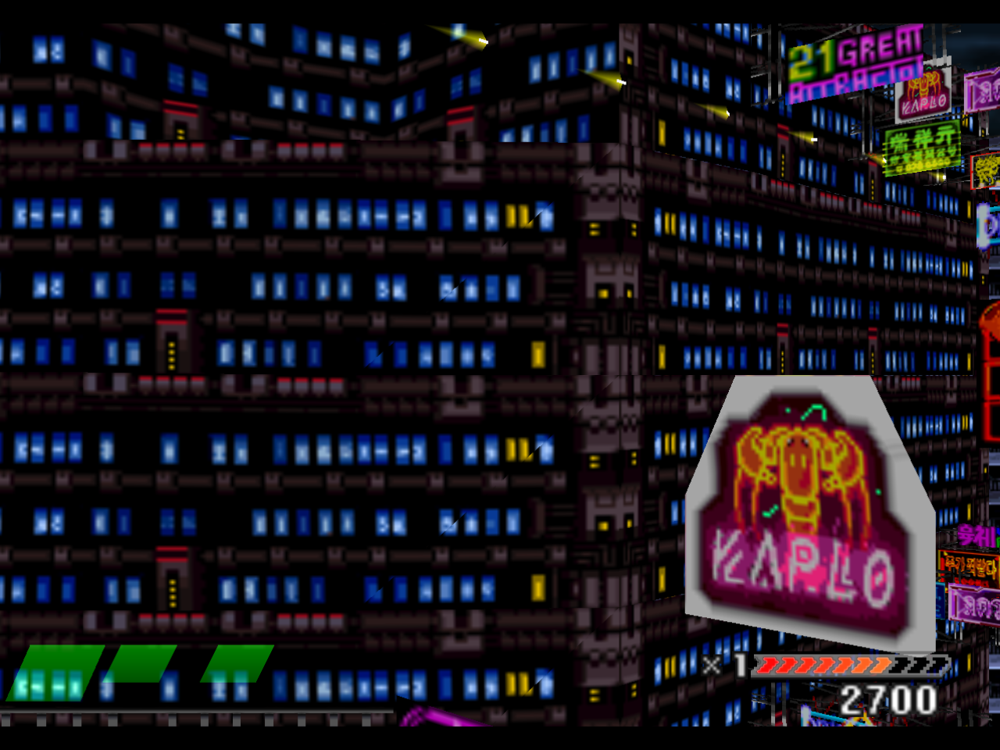
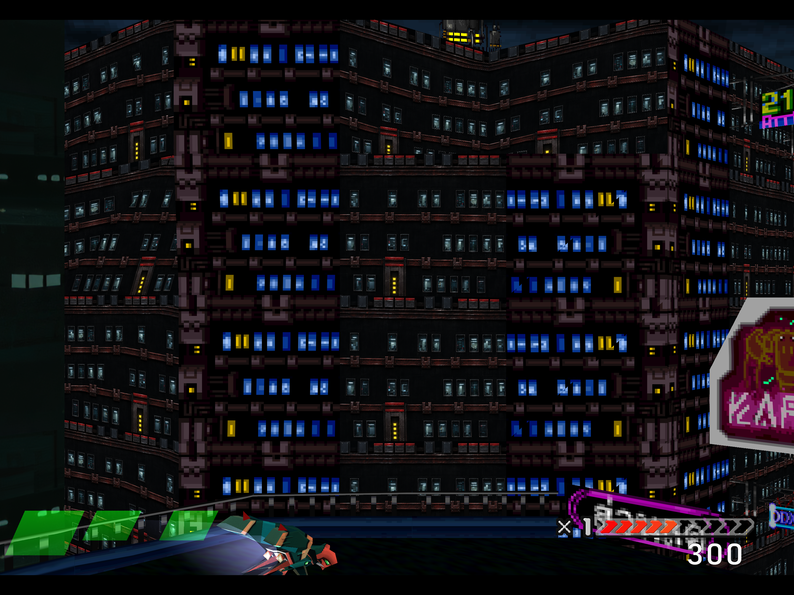

# Reading the comparisons

The showcase distinguishes native texture appearance, an independent DuckStation reference, actual restoration captures and concept artwork.

## Native texture baseline

This is a 1280 × 960 presentation capture from a recompiled-runtime session with HD textures disabled, 4× supersampling, bilinear filtering and no texture dumping. It shows the original texture appearance. It is not an original-console capture or a frame synchronized with the restoration image.

## DuckStation reference

Source: [NoBigDeal La — Einhänder ~DuckStation HD Textures 4K 60FPS PC PS1 Gameplay](https://www.youtube.com/watch?v=vpgemmHly3Q), published November 26, 2025. The uploader credits the textures to **IceBullet**.

The description lists DuckStation 0.1-8891, Vulkan, 32× native internal resolution, nearest-neighbor texture and sprite filtering, and 2160p/60 fps output on an i9-13900K/RTX 4090 system. These are the uploader's stated settings, not an independently reproduced performance result. Other enhancement settings are not inferred.

The README uses an externally hosted video thumbnail and links to the source. It does not republish the user's desktop screenshot or claim ownership of the footage or texture pack.

## Our actual game capture

This is a 2880 × 2160 internal OpenGL readback after a controlled route through title, Mk. II fighter selection, weapon selection and city gameplay. The mapped facade uses the dark photographic material reference and appears on front and angled faces. Adjacent flat blue-window surfaces are separate mappings awaiting authoring.

Source matching and GL submission receipts establish admission. The image establishes visibility. They are sequential evidence, not one atomic sample, complete-background acceptance or a performance result.

## Artwork and runtime status

- **24-window sheet:** an artwork review sheet, distinct from the [actual H24 in-game test](H24-IN-GAME-RESULTS.md). The full 4096 × 4096 master was used in that assisted run, and the entry footage and stills show the mapped interiors; final visual acceptance remains open.
- **Ships and Gunpods:** generated reference-grounded finish concepts; not installed UV textures, geometry or weapon behavior.
- **Material sheets:** RGB detail inputs, without a PBR, HDR or dynamic reflection claim.
- **Title E:** an actual internal title capture with scoped layout review; further UI states and cosmetic issues remain open.

Static reflection/interior artwork can give windows depth and material character. View-dependent reflection and perspective-correct room interiors require additional renderer work and verified camera/geometry data.

## Motion and performance

A separate fresh H24 run now supplies a [continuous 46.1-second entry-to-exit excerpt](H24-IN-GAME-RESULTS.md). Firing is off and the ship is parked near the lower-left; the main facade view is clear around 12 seconds. The game uses normal speed, turbo and rewind off, with timer assistance disclosed. Natural enemy and foreground geometry occlusion remains. The silent 1280 × 960 recording was requested at 30 Hz; final visual and performance acceptance remain open.

The earlier entry-only section of the [H24 results](H24-IN-GAME-RESULTS.md) preserves three original silent window recordings and four full-resolution stills from the November 12, 2026 private run. The entry clip shows the target facade. The middle and later clips document subsequent city gameplay; they do not establish additional H24 placements or palette coverage. The run used normal game speed, disabled turbo and rewind, and disclosed a bounded player-invulnerability timer aid. Encoded recording averages range from about 42.7 to 45.0 frames per second; these measure the video files, not renderer cadence. Final visual acceptance remains false in the saved run proof.

Review full-resolution stills and normal-speed fly-pasts at distant, middle and close placements. Check window readability, dark-wall contrast, highlights, seams, repeat patterns, oblique views and palette changes.

Measure performance with a quiet GPU, identical art/settings and explicit native/present timing. Window-recording frame counts are not renderer cadence measurements. Available telemetry does not separately measure every PNG decode, replacement upload, mip-generation and cache-reentry cost.

Diagnostic clips currently record the actual 1280 × 960 window; separate stills are 2880 × 2160. Synthetic authoring previews are labelled simulations. This gallery does not claim full-game 4K/60 fps, continuous audio or physical view-dependent reflection.

See [per-image provenance](media/gallery/provenance.json) for hashes, dimensions, status and attribution.
