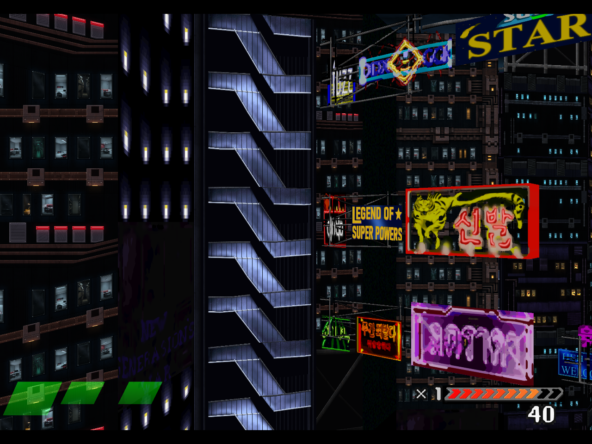
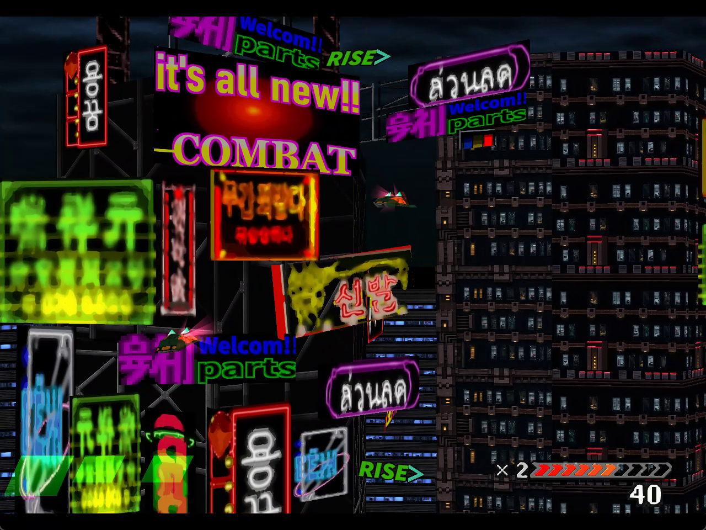
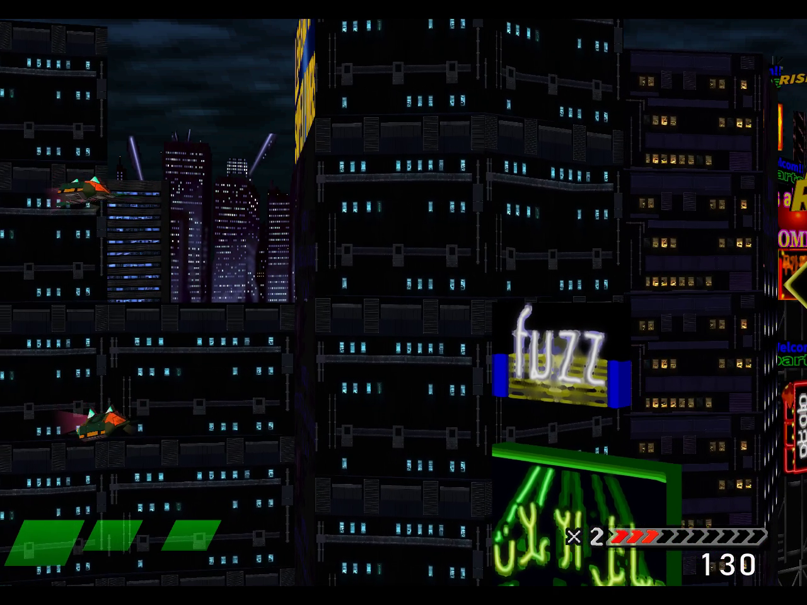
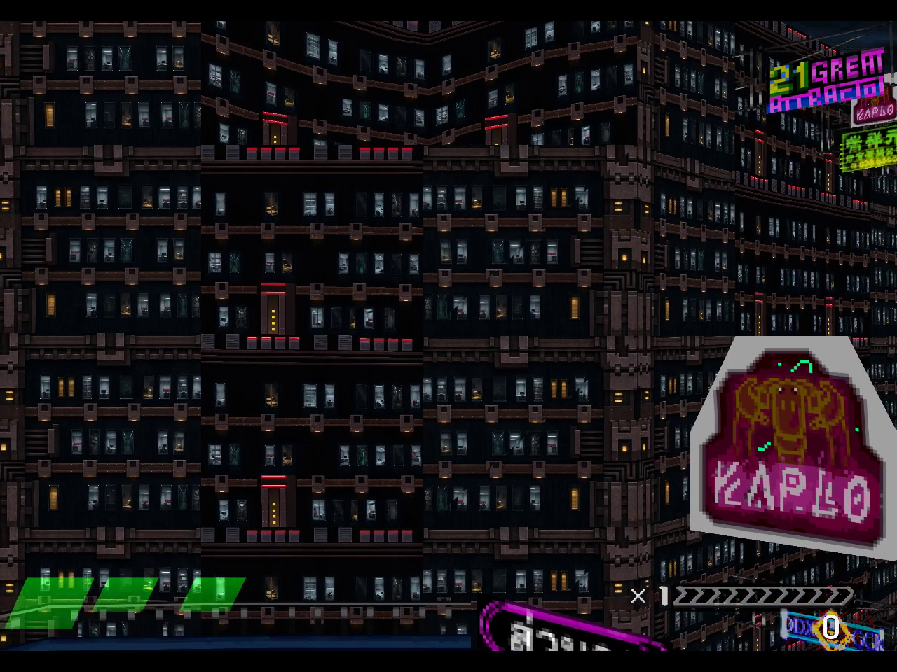
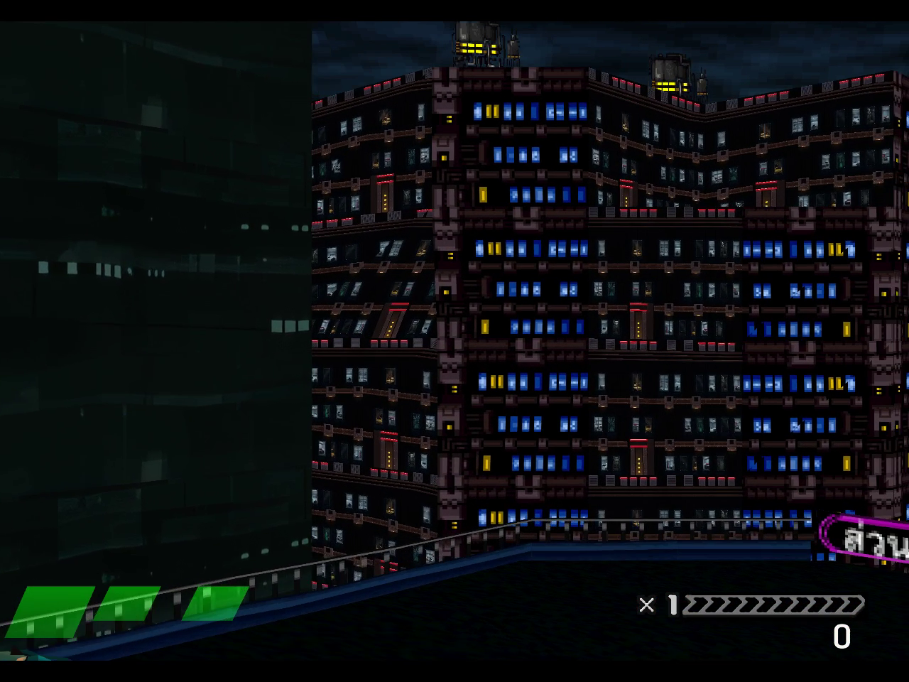
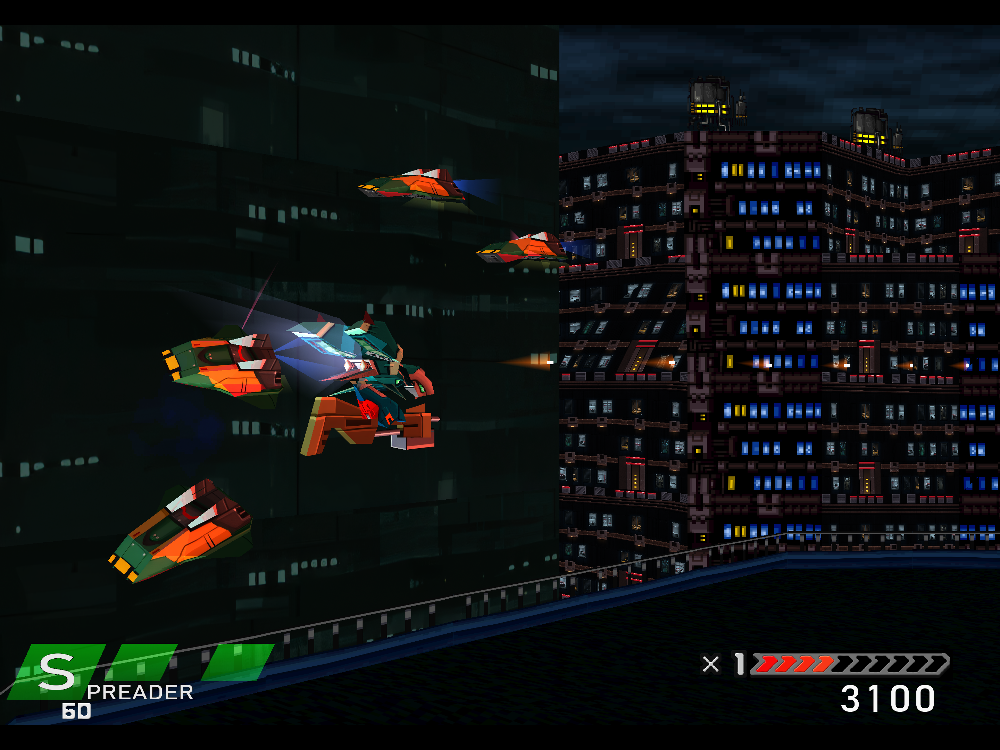
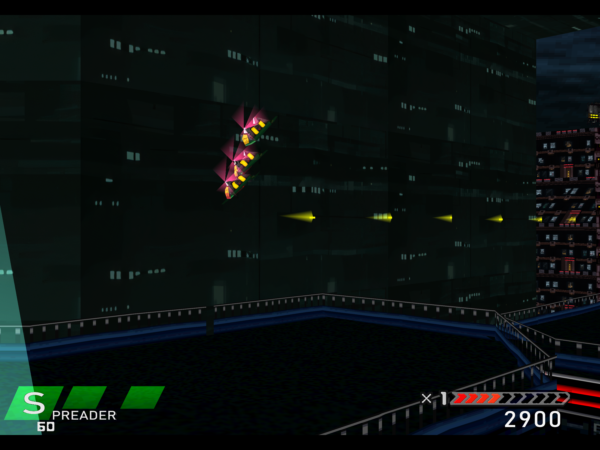
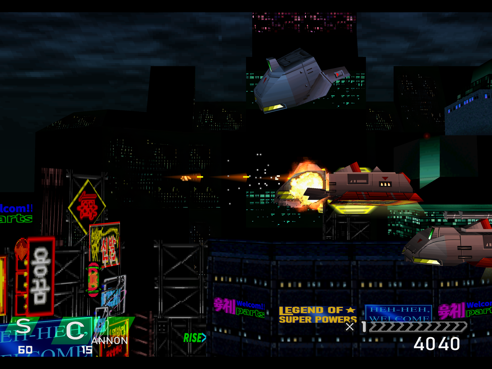
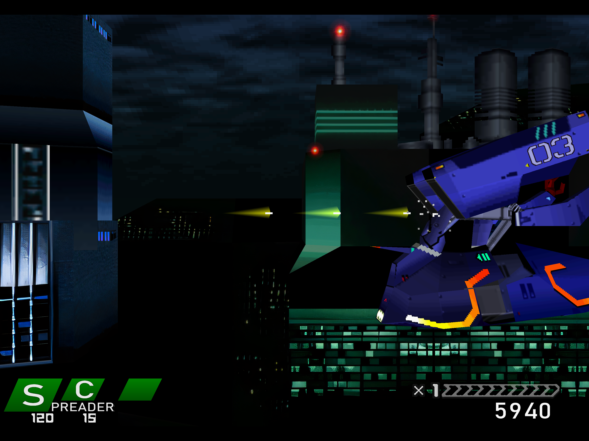

# Full 24-room facade: actual in-game results

## Latest full facade and window lighting — November 13, 2026

[Play the continuous 52.77-second pass](https://github.com/Ghenghis/Einhander-HD/raw/refs/heads/main/docs/media/gallery/stage1-lit-facade-fly-past.mp4)
· [Actual lighting comparison, measurements and limits](STAGE1-EMISSIVE-RESULTS.md)
· [Facade evidence](media/gallery/stage1-lit-facade-fly-past-results.json)

The 837-entry, 1,669-key private composition includes brighter canyon artwork,
two optional emissive masks and corrected Greif pages/strips. All ten delivered
building tiles and both H24 mappings submitted in game. The facade bracket
measured 60.00 guest frames/s without a starvation increment; the full recording
averaged 59.43 and accumulated starvation. Firing was disabled and the timer-only
survival aid is disclosed. Full-stage, audio and installation remain open.

## Earlier 559-entry assembled facade and actors — November 12, 2026

[Play the continuous 49.6-second entry-to-exit video](https://github.com/Ghenghis/Einhander-HD/raw/refs/heads/main/docs/media/gallery/stage1-assembled-facade-fly-past.mp4) · [Coverage, measurements and hashes](media/gallery/stage1-assembled-facade-results.json) · [Angled view](media/gallery/stage1-assembled-facade-angled.png) · [After exit](media/gallery/stage1-assembled-facade-exit.png)

The fresh private `actors-flypast-v4` run uses the 1,492-key pack with 559 authored
entries, retaining the original full 4096-pixel H24 and matched neighboring
facade. It includes the latest frozen sky/menu set, Mk.II hulls, three Gunpod
families and five enemy page groups. In the full 170-second recording, **368 of
559 authored entries submitted replacements**, including all ten delivered
building tiles, the authored wall and tunnel band, all five Mk.II hull/engine
entries, 14 of 27 Gunpod entries and entries from all five enemy groups. This
does not accept unseen phases, all poses or every room.

H24 submitted 21 recorded draws at guest frames 5662–7316; the matched neighbor
submitted 25 at 5725–7360. Front and angled faces are visible in the excerpt,
with natural sign/building/enemy occlusion. Firing was off and one finite
72-frame down-left input parked the ship low. The 180-second timer-only aid made
878 successful writes and stopped without forcibly clearing the countdown.
There were no lives writes, stage jumps, camera overrides or state loads.
Turbo, rewind and interpolation were off. The game exited with code zero and
its debug port closed; quit returned `emu busy or frozen` before closure.

**The telemetry bracket containing all facade submissions measured 59.93 guest
frames/s**, with 1,858 guest frames in 31.001 seconds and no increase in the
audio-output starvation counter. This is the scoped normal-clock facade result.
The full recording averaged **59.21 guest frames/s** and accumulated 98,301
output-starved sample frames. Full-stage pacing and audible audio acceptance
remain open. The excerpt is silent; the variable-rate recording averages about
54.9 captured frames/s, which is separate from guest simulation cadence.

The 1280 × 960 H.264 video is one continuous stream-copy excerpt, with source
presentation timestamps approximately 26.433–76.050 seconds. All 2,725 compressed
packets match a contiguous source sequence; relative presentation/decode
timestamps are preserved within one microsecond. No re-encoding, retiming,
interpolation, upscaling or internal cuts were used. The poster and stills are
lossless frame extractions at public 32, 36 and 48 seconds.

This pass used the verified original-menu route, then enabled the entire frozen
pack after native City verification. The new menu artwork remains separately
unaccepted: three earlier attempts stopped on changed title/selection templates,
and their failed evidence is retained. Opaque HD draw batching was enabled in the
private runtime; CPU attribution, GPU timer queries and experimental world
filtering were off. The video establishes this observed integration, not an
unassisted stage clear, complete art approval or a production installation.

## Earlier 207-entry assembled-world pass — November 12, 2026

[Play the continuous 56.3-second excerpt](https://github.com/Ghenghis/Einhander-HD/raw/refs/heads/main/docs/media/gallery/stage1-world-facade-fly-past.mp4) · [Results, coverage and hashes](media/gallery/stage1-world-facade-results.json) · [Later facade view](media/gallery/stage1-world-facade-angled.png) · [After exit](media/gallery/stage1-world-facade-exit.png)

The fresh private `world-flypast-v1` run uses the assembled 207-entry artwork
candidate, including the ten delivered building tiles, green building atlas,
wall/tunnel window band and sign revisions. The original H24 and matched neighbor
artwork remain present. All ten building tiles, the authored wall and the tunnel
band submitted replacements in the full 170-second run. Overall, 182 of the 207
newly composed entries submitted; unseen phases and later scenes remain untested.
Submission receipts establish mapping, while the video and stills supply the
separate visibility evidence. They do not establish approval of every room or
all remaining city surfaces.

The excerpt begins before the facade enters and continues beyond its departure.
Front and angled placements are visible around 20–40 seconds. Firing is off and
a finite ordinary down-left movement parks the ship low. Enemies, buildings and
signs still cross naturally. The private timer-only invulnerability aid made
856 successful writes during its 180-second lease, then stopped. No lives writes,
state loads, stage jumps, camera overrides or enemy removal occurred. Turbo and
rewind were off. The process exited normally, and the debug port closed; quit
returned `emu busy or frozen` before closure was observed.

**The normal-speed performance target is not met.** The full recording averaged
41.76 guest frames per second with recording/research active. The clip preserves
that actual motion without speed adjustment. It is silent; the audio-output
starvation counter increased by 2,450,917 sample frames, which is not a count of
discrete audible gaps. Recorder-off pacing and continuous audio remain open.

The 1280 × 960 H.264 publication is a single stream-copy excerpt from source
54.2–110.433 seconds. All 1,673 compressed video packets match a contiguous source
sequence, with relative timestamps preserved within one microsecond. No
re-encoding, interpolation, upscaling or internal cuts were used. This verifies
the observed private integration; the reconciled production installation, known
art defects and full-stage acceptance remain unfinished. Newer sky/menu/player
deliveries were not substituted into this frozen recording.

## Matched facade — remaining blue strips replaced

[Play/download the new continuous 46.1-second pass](https://github.com/Ghenghis/Einhander-HD/raw/refs/heads/main/docs/media/gallery/h24-matched-fly-past.mp4) · [New results and hashes](media/gallery/h24-matched-results.json)

A fresh private run (`h24-matched-r3`, November 12, 2026) shows the former bright blue-window strips replaced by recessed photographic rooms, dark glass, rust-brown framing and restrained cool/warm lighting matching the original 24-room facade. The matching surfaces are visible on front and angled placements. **Around 14 seconds** is a clear close view; foreground signs and enemies still cross naturally. The excerpt begins before entry and continues after exit. This establishes the matching building surfaces seen in this pass, not whole-level blue-window coverage.

The added exact-region mapping is `74EF95B7-B30D16F0`, native source rectangle `[800,0,16,64]` words with CLUT `[16,480]`. Its distinct layout was rebuilt rather than aliasing the original texture. New RGB artwork was generated with OpenAI ImageGen at 1254 × 1254 and resampled to 4096 × 4096 for runtime; native 4096 artwork is not claimed for this added strip. Native categorical alpha was preserved independently. The original 4096 × 4096 H24 artwork and all 1,194 other parent keys are unchanged; the candidate has 1,196 PNG keys in total, adding only this neighbor key to the previous 1,195-key candidate.

The actual renderer submitted both replacements as 4096 × 4096 exact regions: 22 H24 samples at frames 5734–7455 and 25 neighbor samples at frames 5792–7428. Video review supplies the separate visibility check. The game route, normal-speed settings and no-fire approach match the earlier test method; turbo and rewind were off, with no state loads or camera overrides. The disclosed 180-second timer-only survival aid recorded 680 successful writes and then stopped. The private run had no top-level errors; quit returned `emu busy or frozen`, followed by confirmation that the debug port was closed.

The silent 1280 × 960 footage was requested at 30 Hz. The 46.1-second publication is a single continuous source 18–64-second excerpt, copied without re-encoding, interpolation, speed changes, upscaling or internal cuts. The poster is a lossless extraction at public 14 seconds. The new and earlier runs are different frames/viewpoints, not a synchronized A/B. Repeated room patterns, seam/palette coverage, all-room readability and frame pacing remain review work; static interiors do not establish dynamic reflections or room parallax. This is a verified private integration, not an installed production-pack release.

The [generated neighbor RGB master](media/gallery/h24-neighbor-material.png) and local integration/capture tools are published alongside this footage; see the [developer notes](DEVELOPMENT.md). The builder gained a project-relative default art input and a read-only verification CLI after capture. The captured candidate pixels remain unchanged, and the original builder snapshot hash is retained in the results.

## Earlier full pass with the blue strips still present — November 12, 2026

[Play/download the continuous 46.1-second fly-past](https://github.com/Ghenghis/Einhander-HD/raw/refs/heads/main/docs/media/gallery/h24-full-fly-past.mp4) · [Full-pass evidence and hashes](media/gallery/h24-fullpass-results.json)

A fresh private run (`h24-fullpass-r2`) captured the full 4096 × 4096, 24-room candidate from before its entry at the right until after its departure. The ship was moved to the lower-left with a finite ordinary movement pulse, then firing was left off. The front/angled facade is clearly exposed around **12 seconds** into this excerpt. Foreground buildings and signs temporarily occlude it as the camera moves; enemies still cross naturally. No enemies were removed and the camera was not overridden.

The footage shows photographic rooms on dark structural panels, interspersed with remaining bright blue-window mappings. Repeated static room patterns are visible. This is better evidence for motion review than the earlier entry-only clip, while final realism approval, individual readability of all 24 rooms, seam/palette coverage and performance acceptance remain open.

The game ran at normal-speed settings with turbo verified off at both ends, rewind disabled, no fast-forward and no state loads. A timer-only invulnerability aid used a 180-second lease and recorded **694 successful writes**, then stopped. This is assisted visual-review footage. Claude confirmed a quiet GPU window before launch; that window was released after recording.

The silent source recording is 115 seconds at 1280 × 960, requested at 30 Hz. The published file is one continuous excerpt requested from source seconds 18–64, trimmed with H.264 stream copy and an MP4 edit list. Its measured duration is 46.1 seconds; no re-encoding, speed change, interpolation, upscaling or internal cuts were applied. The poster is a lossless extraction from public video time 12 seconds, not a separate 2160p readback. File capture cadence does not establish renderer frame pacing or 60 fps.

Preparation verified all 1,195 PNG hashes, with 1,194 parent keys unchanged and categorical alpha preserved. The frozen master hash matches the earlier run. Exact-key draw samples span game frames 5723–7433. The all-vertices-left-edge detector did not trigger; **entry and exit were verified in the actual video**, not inferred from absent draw samples. The run recorded no top-level errors. The quit reply was `emu busy or frozen`, followed by a successful debug-port-closed check; graceful quit success is not claimed.

## Earlier entry-only run

Tested November 12, 2026, 5:22–5:25 PM Arizona time (November 13, 00:22–00:25 UTC). Run: `h24-v2-4096-r1`, Windows OpenGL recompiled runtime.

The full 4096 × 4096 H24 v2 master reached the running game. The entry video and two adjacent internal stills show its varied room interiors on front and angled building faces. This establishes visible integration of the candidate. Final visual approval remains open: the saved proof records `live_visual_accepted: false`.

### Watch the actual footage

- [Entry fly-past — 6.00 seconds](https://github.com/Ghenghis/Einhander-HD/raw/refs/heads/main/docs/media/gallery/h24-fly-past-entry.mp4). The target building enters from the right. The dark faces contain the new interiors; the bright blue-window sections use other mappings.
- [Middle recording — 6.00 seconds](https://github.com/Ghenghis/Einhander-HD/raw/refs/heads/main/docs/media/gallery/h24-fly-past-middle.mp4). Subsequent city gameplay from the same run; additional H24 visibility is not established.
- [Later recording — 5.95 seconds](https://github.com/Ghenghis/Einhander-HD/raw/refs/heads/main/docs/media/gallery/h24-fly-past-later.mp4). Further city gameplay from the same run; additional H24 visibility is not established.

These are three separate, byte-identical copies of the original captures, with gaps between recordings. They are silent H.264 recordings of the actual 1280 × 960 game window, captured with FFmpeg `gdigrab`. No synthesized frames, retiming, upscaling or continuous-traversal claim is added. Game turbo was explicitly queried as disabled before evidence capture; the route used no fast-forward and configured rewind off.

**Assistance disclosure:** a private player-invulnerability countdown aid was active, with a 180-second lease. The run records 614 successful one-byte writes to that timer and no lives writes, stage jumps or state loads. The helper stopped after about 124 seconds, without forcibly clearing the live timer. This is assisted visual-review footage. It is not evidence of unassisted survival or gameplay balance.

### Full-resolution stills

Each still is a separate synchronous internal OpenGL readback at 2880 × 2160. Public PNGs use lossless compression with identical decoded pixels; no crop or resize was applied. Their frames bracket or follow the video and are not asserted to be exact video frames.

#### Target entry, frames 5800–5802

#### Front and angled faces, frames 6080–6084

#### Subsequent city view, frames 7692–7694

#### Later city view, frames 8890–8893

### What the test establishes

- Preparation verification checked all 1,195 PNG keys: 1,194 parent keys were unchanged, and the one facade replacement preserved categorical native alpha. The run used the full frozen 24-room master at 4096 × 4096.
- The recorded native route passed title, fighter selection, weapon selection and City gates before the facade test. User memory cards were not mounted.
- The renderer submitted exact-region replacement key `52F33418-5E9B9AC3` at frame 5742 with a 4096 × 4096 replacement. A draw receipt alone is not visibility proof; the entry footage and the adjacent stills supply the visual evidence.
- The photographic rooms and dark structural bands are visible on front and angled faces. Adjacent blue-window sections remain different mappings, so this is partial building/scene coverage.
- The saved run contains no top-level errors. Input was released and capture stopped. The quit command returned `emu busy or frozen`; the subsequent process-close check reported the debug port closed. The quit reply is not described as a successful graceful shutdown.

### What remains open

The six-second entry clip is a short approach view. It does not show a complete close-to-distant traversal or establish readability of every one of the 24 authored rooms. The middle and later recordings primarily show other buildings and do not extend the exact-key visibility result. Seams, repeated placements, all palette variants and final realism still need review.

The windows use static interior/reflection artwork on existing geometry. This test does not establish view-dependent reflections, room parallax or a PBR renderer. The experimental facade motion-sampling mode was disabled.

FFprobe counted 270 frames in the 6.00-second entry file, 256 in the 6.00-second middle file, and 268 in the 5.95-second later file. Their average encoded rates are about 45.0, 42.7 and 45.0 fps. Normal game-speed settings do not establish stable real-time renderer cadence. Window recording adds load; performance, hitching and continuous audio acceptance remain open. No audio stream was recorded.

### Evidence and provenance

[Machine-readable results and artifact hashes](media/gallery/h24-in-game-results.json) preserve selected facts from the saved run and hashes of the private source receipts. [Gallery provenance](media/gallery/provenance.json) identifies each public asset, original source and pixel-preserving encoding. Private launch configuration, disc paths, saves, runtime binaries and replacement packs are excluded.

The entry-only publication packaged an existing run. The full-pass section above documents a separate fresh game run.
