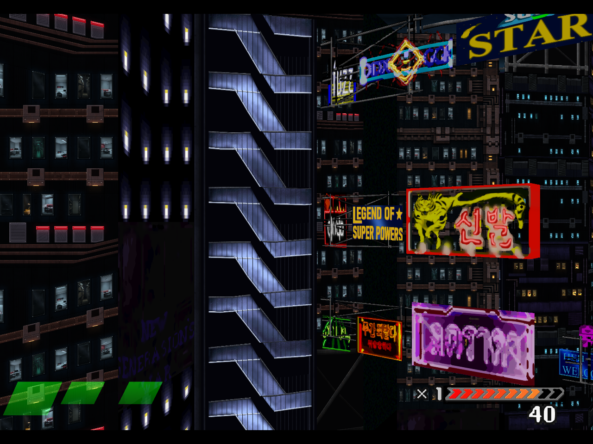
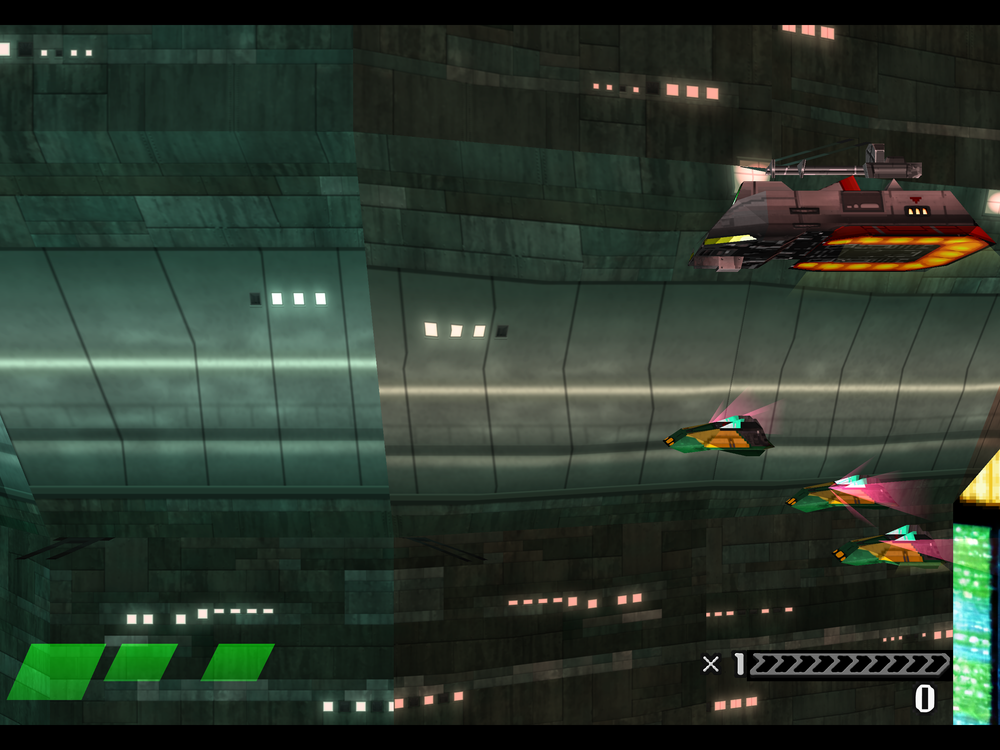
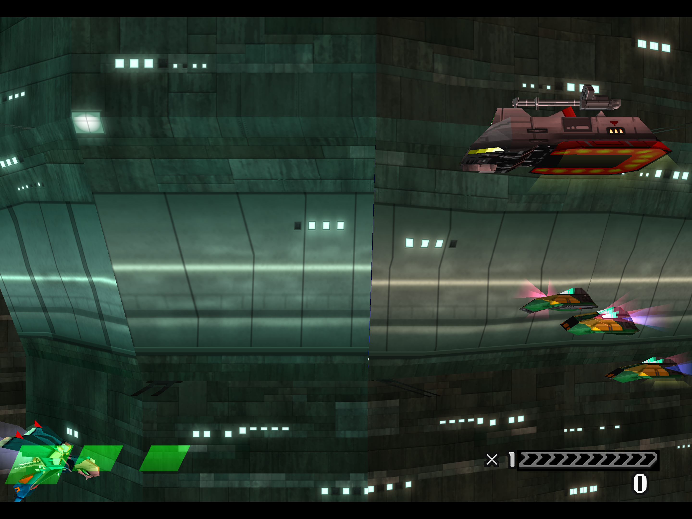
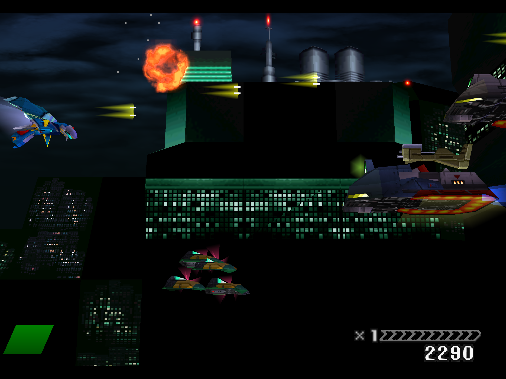

# Window lighting and updated facade: actual results

November 13, 2026. The optional window mask now preserves authored light colour
on the revised canyon wall and matching band while the surrounding surfaces
retain the game's vertex shading. **The full remaster and Stage 1 release are
still incomplete.**

[Play the continuous 52.77-second entry-to-exit video](https://github.com/Ghenghis/Einhander-HD/raw/refs/heads/main/docs/media/gallery/stage1-lit-facade-fly-past.mp4)
· [Facade results and hashes](media/gallery/stage1-lit-facade-fly-past-results.json)
· [Lighting comparison and pacing evidence](media/gallery/stage1-emissive-results.json)

The private pack contains 837 authored entries in 1,669 keys, plus two grayscale
mask companions. All 226 native region checks passed. It includes the corrected
Greif v3 pages and strips, with all 116 imported images preserving the native
class at every texel centre. The full recording positively sampled 405 authored
entries, including all ten delivered building tiles and both full-facade
mappings. Missing sampled rows do not prove a texture was never drawn.

The video is actual 1280 × 960 game output, with firing disabled, normal clock
settings, turbo/rewind off and a disclosed 180-second invulnerability-timer-only
aid. No lives or stage position were changed. Its 3,008 packets match a single
contiguous source sequence, with relative timestamps differing by at most one
microsecond. There is no re-encoding, scaling, interpolation, retiming or
internal cut. The video is silent and variable-rate.

The telemetry bracket containing both facade mappings measured **60.00 guest
frames/s with zero audio-starvation increment**. The full 170-second recording
averaged **59.43** and accumulated **65,521 starved sample frames**. This remains
a scoped visual result; it does not establish full-stage pacing or audio.

## Canyon lighting comparison

Actual 2880 × 2160 captures, losslessly PNG-compressed with unchanged pixel
bytes. The captures are sequential and not frame-aligned; their composed-frame
brackets and source hashes are recorded in the evidence. No exact brightness
ratio is inferred from these different camera placements.

Masks off: panes inherit the wall's vertex-colour shading and warm tint.

Masks on: marked panes retain the authored cyan/white and lamp brightness.
Wall panels continue to receive the native shading. This is an authored RGB
lighting exception, not dynamic room illumination, reflections or parallax.

## Recorder-off opening check

Two fresh runs used the same runtime and candidate with native menus preceding
the measurement. Source dumps, recording, GPU timer queries, rewind and survival
assistance were off. The shared CPU/GPU authoring window was quiet.

- Masks off: 1,802 guest frames in 30.0002 seconds, **60.07 guest frames/s**;
  zero additional starved sample frames. Initial audio fill: 136.9 ms.
- Masks on: 1,860 guest frames in 31.0002 seconds, **60.00 guest frames/s**;
  2,047 additional starved sample frames. Initial audio fill: 0.3 ms.

The one-Hz observations include frame quantization and command-time differences.
The differing starting buffers prevent attributing starvation differences solely
to the masks. One opening pair does not establish no overhead, resolved audio,
or sustained full-stage cadence.

A later 170-second same-route test also disabled source collection and
measurement stills. It averaged 59.9238 guest frames/s with 9,061 additional
starved sample frames, concentrated near seconds 148–149. It retained the
timer-only aid and no firing. [The actual counters and limits](STAGE1-UI-RESULTS.md#audio-and-cadence-follow-up)
remain short of full-combat or audible audio acceptance.

## Implementation and remaining work

The startup option is `PSXRECOMP_HD_EMISSIVE=1`; it remains **off by default**.
Each optional `<replacement key>-emissive.png` is 8-bit grayscale and matches
the replacement's dimensions. The composer applies the same exact-region crop
to RGB and mask. These two masks occupy 3 MiB as R8 GL textures, within a 64 MiB
additional mask limit. Decode runs on the existing bounded worker, and mask bytes
count against its existing cache budget.

Mask values blend vertex modulation toward the authored RGB colour. Cutout/STP
authority, semitransparency passes, raw primitives and native fallback edges keep
their prior semantics. Invalid mask dimensions or encoding cannot affect the
replacement. The production adapter resets the mask gate when switching to an
unmasked key. The combined runtime passed **731/733 real-GL checks**, including
loader, lease, budget, brightness, class, raw/fallback and key-switch checks.

A subsequent v28 shader qualification changes the mask target to
`max(vertex_rgb * 2, 1)` per channel. This preserves lighting that was already
above neutral. Its mixed-channel and partial-mask regressions pass within
735/737 real-GL checks. Two additional delivered region-O distant-city masks
are registered in a fresh private composition. Both were submitted in game;
[the actual 2160p still and component receipts](media/gallery/stage1-atlas-window-mask-results.json)
retain their separate v28 provenance. All authored RGB images are unchanged;
the four masks total 11 MiB as R8 textures. Full motion/material acceptance
remains open. The video and comparison above retain their original v27 provenance.

The replacement pack and runtime binary remain private and uninstalled. Further palette,
pose, UV/material, full-stage/audio, interface, normal-launcher and rollback
acceptance is required. The 157 missing historical HUD fade palettes, later
stages and unlock/end states remain open. Earlier failed stage attempts are
retained and are not counted as successful progression.
