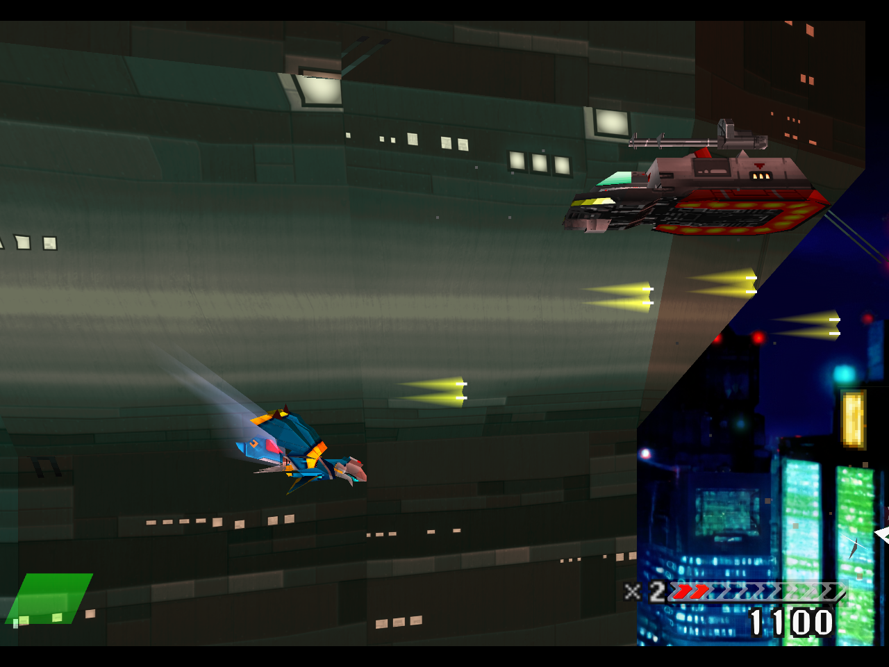

# Mk.III authored hull gameplay results

November 12, 2026. Six new Mk.III bindings were positively drawn in actual
gameplay. This is component evidence; Stage 1 and the full remaster remain open.

[Play the 24.8-second gameplay excerpt](media/gallery/stage1-mk3-gameplay.mp4).
The silent 1280×960 clip is one continuous section of the owned game window's
recording. All 1,078 compressed video packets and their relative timestamps
match the source: no retiming, interpolation, scaling, re-encoding or internal cuts.

The private candidate contains 729 authored entries in 1,562 keys. All 220 native
region checks pass. The two new hull pages use 1024×1024 calm exports. The
recovered B24C6DA2/DB715733 strips and the 59471BC6 cell overlay use 4096×128
exports. One 1024×1024 exact binding replaces only the proven grey mechanical
cell of the mixed source page; neighboring HUD content remains outside that
binding. The strip overlay preserves every pixel outside the cell. Shared
Mk.II/Mk.III hull keys retain their existing artwork.

The first-occurrence GL log positively records all six new registrations,
including the derived `C1B4BAA3-E0AE221F` cell. It also confirms HD SPREADER and
VULCAN wordmark submissions. These receipts establish admission; they do not
accept every pose, UV seam, palette phase, pickup transition or material detail.
The native palette saturation, small dark edge blobs and model-kit appearance
documented by the artist still need review. The foreground Greif's flat blue
phase is also retained as a visible review item.

The run selected Mk.III through verified native menus before enabling the full
pack. Player tint/detail controls were off, preserving the authored PNG colors.
It used ordinary automated controller input, survival assistance off, no RAM
writes, no state loads, no automatic Continue, no rewind and no turbo.
It closed cleanly after 180 seconds with two lives remaining. **It did not
establish a stage or boss clear.**

Thirteen retained GPU-frame rings contain 5,665 GP0 commands in total, providing
denser pose/UV evidence for the artist. They precede the sequential screenshots;
the captures are not atomic. Ring retention, entry counts and the twelve-word
command-payload limit still apply; this is not a complete replay.

With source capture, dense queries, stills and video active, the whole observed
interval averaged 43.31 guest frames/s and accumulated 2,367,843 additional
output-starved sample frames. Recording load and this test profile prevent a
recorder-off pacing/audio claim. The [machine-readable result](media/gallery/stage1-mk3-results.json)
retains controls, exact positive submissions, hashes, media packet proof and
dense-frame references. The candidate remains private and uninstalled.
