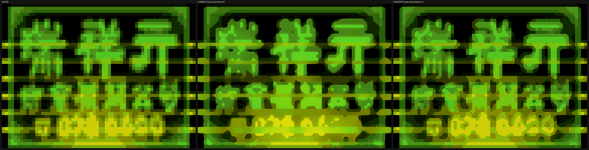
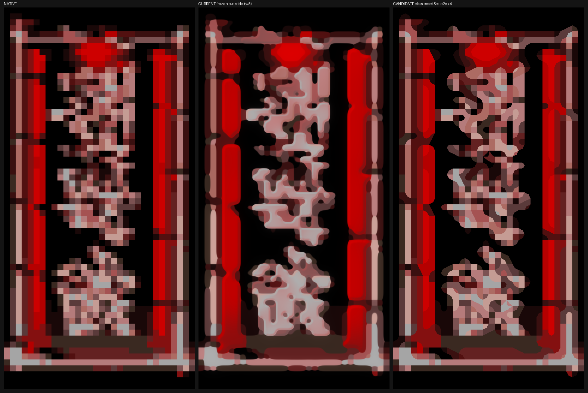

# Green and pink sign quality — November 14, 2026

## Current verified state — timed GPU reservation; CPU integration November 14

The user's 3090 Ti reservation runs **11:44:30–12:44:30UTC (04:44:30–05:44:30 Phoenix)**. CPU-only work continues from C:, one below-normal compiler/worker at a time. The 3060 is permitted if needed but has not been used for this work. The user already authorizes 3090 reuse after the hour; check actual availability and take an owned bounded test reservation then. The previous indefinite hold is superseded.

Root independently verifies all 306 Claude-v4 pins, recompiles/replays 6,185 fixture checks and six exact GL-stub integration modes, all passing. Scoped default-off RGB edges skip opaque pages and combine with offline class mips; no GPU/game acceptance is claimed. V62's broad unlaunched candidate is retired after review. Private v63 and v64r2 compile/link; v64 adds actual submitted GP0 packet capture. Its collector passes 1,626 enabled / 6 disabled CPU checks, and its exact TCP handler plus Windows adapter passes eight CPU RPC cases. Both executables remain unlaunched; retained parent objects mean these are not clean full-source rebuilds. [Source, raw results, hashes, retained failures and payload limits](../remaster-audit/cpu-hour-integration-20261114/README.md).

The bounded scene observer is a real private engine hook, default OFF: explicit next-frame arm/seal, 1024 polygon cap, full raw topology/material/projection input, copied readback and overflow rejection. It still needs live qualification and connection to scene submission. Combined camera/object transforms, PSX compositing/material fidelity and full scene coverage remain unresolved. Prior real Remix SDK output remains black and Shutdown stalls; ray tracing/DLSS are not working in-game. A newly inspected official source lifecycle issue is only a hypothesis against a different runtime revision.

The fringe census identifies 136 sampled drawn texture keys above 8/255 mean bilinear RGB bleed;437 / 1,110 drawn keys are opaque. Claude is implementing separately identity-bound RGB-only sidecars, while strict native-class defects remain open. RISE's hybrid repair was rejected; faithful upright HD composition with exact native gaps/arrow is the chosen replacement direction. Far-background clarity/buildings, full artwork coverage, ship/weapon/enemy/boss skins and selectors, modern HUD/menus, audio remastering and seven-stage acceptance remain incomplete. The prior v61 live run still fails audio/smoothness acceptance; no new game/audio test was run during this CPU checkpoint.

Earlier checkpoints — superseded resource policy and retained historical evidence

## Current verified state — GPU tests ended; CPU-only hold November 14

The user has now taken the RTX 3090 Ti for another project (11:30 UTC). All owned GPU/game tests have ended; a new user reservation has no automatic expiry. Further GPU work waits for explicit return. Continue CPU-only work from C:, below normal; leave the RTX 3060 project untouched. The [GPU integration packet](../remaster-audit/gpu-integration-20261114/README.md) records actual results and preserved failures.

Private v61 now ran in-game: a 30-second early-city diagnostic found 99.16% all-hit textured-triangle calls, with every successful vertex lookup exactly one frame old. The private adapter now supports explicit maximum lag one and passes 86 host checks; it is not connected to the game frame hook. This uncached diagnostic **fails audio/smoothness acceptance** (+480 frontend underruns, +287,368 bridge counter; later slowdown). Phase rows returned the boot window, so they cannot attribute the slowdown.

Real Remix GPU Startup/resource/camera/draw/Present/external-image calls return success, but output is black and Shutdown stalls, including separate-window/FBO/alpha-test/240-frame controls. Every owned probe is closed; this is a failed backend qualification, not ray-traced gameplay or DLSS integration. Shader readiness remains unmeasured. Existing texture ingestion is separate from this renderer failure.

Claude's frozen class-aware mip prototype passes root's independent 7,410-check replay. Its partial Stage1 analysis flags 241 drawn texture keys under a documented policy; that is not a distinct-sign total or automatic art rejection. Strict native-authority sidecars and private renderer integration are being implemented, with GL/full-link/in-game acceptance still pending. The distant green/pink signs, whole-cell masks, background coverage, realistic ship/gun/enemy/boss skins and selectors, modern HUD/menus, audio remastering and seven-stage acceptance remain unfinished. Full remaster completion is not claimed.

Follow-up actual GPU shader testing now shows stable synthetic strokes at4×/8×, but still fails at12× and retains the LOD0 fringe; overall exit1. Root also rejected synchronous95–344ms mip generation on the draw thread. Native Remix presentation without OpenGL/custom material still fails image/lifecycle qualification. A newer official SDK0.16.1 header is incompatible with the installed renderer (CPU probe error8); it has not been installed. [Raw follow-up evidence and review](../remaster-audit/gpu-shader-followup-20261114/README.md). No private class-mip game executable is accepted.

A separate default-off RGB edge-filter prototype now removes the synthetic LOD0 fringe on the3090Ti, including fractional LOD controls, while preserving tested cutout/STP support and point sampling. This narrower GPU goal passes; the original overall suite still fails at12×/LOD0 identity, and no game integration or performance acceptance is claimed. Exact source/results are in the follow-up packet above.

The guarded RGB variant now preserves the tested all-opaque result exactly, including mixed-STP controls. A separate default-off level0 RGB-only private v62 executable compiles/links (two TUs rebuilt, pinned parent objects retained) and its preprocessed shader matches the GPU-tested branch. A short visual candidate was prepared but **not launched before the user took the GPU**. No new in-game fidelity/performance/audio acceptance is claimed.

CPU-only follow-up: Claude v3 now precomputes mip levels offline and preloads a bounded cache. Root verifies212 frozen pins and independently recompiles/replays6,182 fixture checks plus28 opt-in/2 opt-out GL-stub checks, all passing with the user GPU hold unchanged. These are CPU stubs, not GPU/game acceptance. Region O gets no useful class-mip benefit; eight verified cutout keys replace that initial target. V4 RGB integration remains ongoing. Source/evidence and local-payload omissions are explicit in the follow-up packet.

Earlier checkpoints and evidence — historical, before the GPU return above

Further CPU integration is verified: the real GTE RTPT → SWC2/PGXP DATAFLOW → SDK-layout staging host test passes **85 checks** with synthetic guest input and a dummy material. Claude's v3 census adds lag/flag/projection diagnostics; root verifies its frozen run4 pins, reruns all four host executables (74/137 checks plus controls) and compiles/links a new private v61 executable. It has not been launched, and the mesh adapter is not connected to its runtime frame hook. Failed TCP/mutation controls and the rejected stale runner hash remain explicit in the [CPU metrics packet](../remaster-audit/engine-cpu-metrics-20261114/README.md). No GPU work, scene rendering, ray tracing, DLSS or new in-game performance/audio acceptance is claimed.

The follow-up [CPU review packet](../remaster-audit/engine-cpu-review-20261114/README.md) preserves Claude's independent mesh review and root's revised adapter: **71 host checks pass** with transform-hash and command/lane validation. Strict world-v3 class audit: 1,182 pass, **299 mismatch**, 218 lack a qualifying native source in the audit; 142,550 mismatching native centres. Root's 13 audit controls and source-hash/complete-word proof checks pass. These are explicit inherited defects, not full-pack acceptance; some older prepared fixes only stamp centre pixels. GPU/game hold remains in force. The newer v3 host delivery and private compile/link above supersede that preparation checkpoint; live measurements remain pending.

The newest CPU-only world-v4 adds the teal K-panel revision after proving 3,550 class mismatches in its world-v3 page. Both frozen size alternatives preserve all 65,536 native-centre classes; the private 2048 composition passes 1,699-key/226-region native admission. RGB edits stay inside K. It has not run in-game. Distant green/pink dot-grid region O already has t3 artwork and needs sampling/footprint/motion validation; it is distinct from the previously unauthored teal region K. The strict world-v3 audit and first mesh review are now complete, with defects and revised host checks recorded above; later integration remains underway. [Actual checks and retained limits](../remaster-audit/engine-cpu-integration-20261114/README.md).

CPU-only addendum after the user reserved the RTX 3090 Ti: the newest private world-v3 candidate has 1,699 keys after resolving the remaining source bindings and Uhu companion family. Both additional composition rounds passed native admission and 3,874,816 native-centre class checks across 63 entries with zero failures. It now targets all 21 absent and 126 legacy-with-unused-art keys in the earlier sampled census. This is a bounded integration list, not full-world or 4K fidelity acceptance. No new game or GPU test ran; the last live world-v1 audio failure remains open. Resolution alternatives, derived strip provenance, the missing Uhu CLUT and distant window defects are explicit in the [CPU addendum](../remaster-audit/world-cpu-completion-20261114/README.md). The user GPU reservation remains active until explicit return/authorization.

Live-tested world-v1 integration: [actual candidate and live results](../remaster-audit/engine-foundation-world-20261114/README.md) cover 161 patches and 1,698 total keys, including the four existing W5 cube/sign-row cells. Native admission and class checks passed; 140 changed keys uploaded during 120s of private gameplay. No per-key draw or final visual approval was established. That live-tested candidate retained the distant95A3BCF8 atlas; the newer K/O findings and unrun revision above supersede its authoring status. Audio added 3,351 starved samples in the first measured second, so this run does not pass audio acceptance.

Broader world census: the distant green/pink panels inspected in `world-075` and `world-090` map by layout/UV and retained older draw logs to the `95A3BCF8` city window-light atlas, not lettering. The teal `723E222C`, green `60245B3A` and pink/orange/white `07A9568D` palettes have soft/grainy selected replacements. This is a cross-run mapping, not atomic draw-to-pixel proof. That earlier broad authoring diagnosis is superseded by the K/O distinction above; authored region O still needs actual motion/sampling qualification. The [world census](../remaster-audit/world-sign-census-20261114/WORLD-SIGN-CENSUS.md) also found 21 drawn keys absent from the tested pack and 126 drawn legacy keys with deliverable candidates not integrated. These are sampled texture-key counts, not a complete distinct-sign count. The four cube/sign-row cells previously called authoring gaps already have W5 candidates; their remaining work is integration and live validation.

Latest continuation: five private class-preserving sign revisions (boards 4, 9, 10, 12 and 26) passed native pack admission and ran through a light 120-second gameplay check. Sparse captures still show uneven quality; the distant green/pink signs and potentially untreated buildings remain open. No full visual acceptance or production installation is claimed. [Actual live results](media/gallery/sign-crisp-v2-live-results.json) and [full 4K/Remix implementation scope](4K-REMIX-IMPLEMENTATION-PLAN.md) supersede the earlier four-board prepared-only snapshot below.

The remaining distinct-sign total is **unknown**. The older register has 37 rows: 29 numbered boards, three posters and five request rows; later W4 work resolves some requests, so these are not five current missing signs. Two numbered entries are an indicator and a backing panel, leaving 30 named sign/poster rows. The 42 artwork entry records include variants and cannot serve as a distinct-sign denominator. Four cube/sign-row cells already have W5 candidates and now enter the private world composition; live look validation remains open. Eleven late-city source/phase records require resolution. These units overlap and must not be summed. [Source-bound census receipt](media/gallery/sign-census-progress-results.json).

**The washed-out signs are unresolved visual defects. They were not accepted as finished HD artwork.** The user's smoother gameplay report does not approve the sign artwork. There is no verified fraction of all signs completed; the existing 42 authored sign entry records are not a complete sign/state denominator.

Claude performed a C-only source/pack audit and built private alternatives without GPU generation. Root inspected the green-sign comparison. The exact native glyph reading is unverified; no new Japanese/Chinese text was invented.

## Identified targets and current assets

- Green three-glyph board 9: exact-region key `0FB1EFC5-F6269484`, native 64 x 48 texels.
- Pink glyph column board 4: `7A652858-600290FE`, native 32 x 64 texels. Its earlier ledger already left blotchy lettering open.
- Red script banner board 10: `67DC56D7-8D0C6ABE`, native 64 x 48 texels; lower lettering remained lumpy.
- Magenta oval board 12: `327E6D9E-89C41FFB`, native 64 x 32 texels.

These four boards share FD81C3C7 atlas layout and palette-phase identities. The installed 964-PNG pack contains older full-page replacements; it has no exact-region overrides for these boards. Its sampled native texel centres remain close to native colors. This is a static source observation, not fresh in-game appearance acceptance.

The larger frozen `frozen-w3-lit-v1` candidate used in the latest gameplay diagnostics contains the W3 exact-region overrides. Their glyph contours are rounded/softened and their shading is pale, which is visible in the comparisons below. Correct alpha-class checks had passed, but those checks did not establish legibility or visual quality. A ledger selection marked USE must not be treated as final visual approval.

Each comparison shows **native source on the left, the current frozen override in the middle, and an unaccepted sharper alternative on the right**. Alpha is displayed using the game's class interpretation, not ordinary image opacity.

## What was created, checked and still needs work

The private `fd-glyph-boards-crisp-v1` alternative applies class-aware EPX/Scale2x four times to each board's source words and CLUT. It uses neighboring source colors/classes and preserves native texel-centre classes. Claude's four-board report records zero new colors/classes and zero native-centre class mismatches. Same output dimensions and keys make private composition possible; they do not establish visual acceptance. Native dither remains busy and can form distracting shapes. This is a sharper source-based alternative, not newly reconstructed HD lettering.

The original W3 files, native inputs and alternatives remain preserved. No alternative was installed, and no new in-game A/B ran during the Remix setup. The next gate is a hash-pinned private composition and a light same-route visual comparison at gameplay size, including the green/pink boards, their palette states, UV edges and motion. Compare improvements per board instead of applying a global sharpening filter or accepting every alternative together. Board 26's yellow-on-magenta glyphs remained outside this initial four-board snapshot.

Local audit: `C:/github/Einhander/remaster-audit/claude-backlog/sign-washout-audit/AUDIT.md`, with `stats.json`, `candidates-report.json`, the source-based builder, comparisons and `frozen/fd-glyph-boards-crisp-v1/manifest.json`. The [published audit receipt](media/gallery/sign-quality-audit-results.json) binds selected local source hashes and the two included comparisons. This does not make the local full artwork pack a portable release.

The [Remix conversion check](RTX-REMIX-SETUP-20261114.md) successfully converted an existing W3 sign to DDS and preserved the original. That conversion did not repair the soft artwork and is not installed in the game. [Overall artwork scope](ARTWORK-STATUS-20261113.md), later stages and normal full-stage acceptance remain incomplete.

