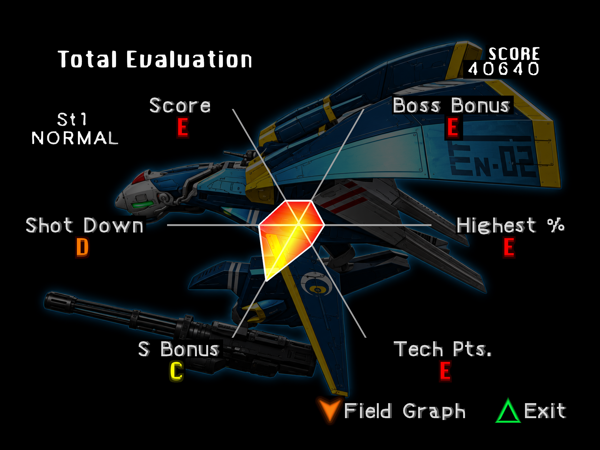
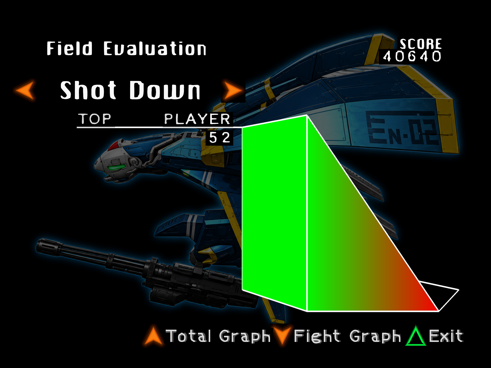

# Stage 1 HUD and results observation

November 13, 2026. A fresh private run reached Total Evaluation and its Field
Evaluation graph with survival assistance off. Nine delivered font bindings
were positively submitted by the GL renderer. **The interface is not complete.**

[Structured UI result](media/gallery/stage1-ui-results.json)
· [Quiet-route cadence result](media/gallery/stage1-quiet-route-results.json)

These are actual sequential 2880×2160 renderer captures. Publishing applies
lossless PNG compression and removes metadata; pixel bytes and dimensions are
preserved. They are not atomic with the adjacent telemetry or composed captures.
The background and glyphs contain mixed delivered and native content; observing
these screens does not establish every glyph's quality or a stage clear.

The bounded 600-second Mk.II census used the 837-entry private composition and
v27 runtime. Native menus preceded pack activation. The run used normal pad
input, no invincibility, no state loads and no automatic Continues. It closed
with no runner errors, exit code zero and its debug port closed.

A finite six-frame Down input opened the Shot Down field graph. A finite
Triangle input exited into the native opening movie. A finite Start input then
reached the native story text. **Return to title was not observed.** The hires
API rejected the movie's 24-bit scanout; supported composed-only captures were
retained instead. That limitation is not counted as a successful hires capture.

The census retained 837 valid native texture/palette pairs and rejected 14
incomplete validity maps from unrelated actor/pod strips. The aggregate source
verifier therefore exited with failure; only its individually valid pairs are
usable. It recovered **none of the 157 historical missing HUD fade palettes**.
Those entries remain unresolved, with no invented palette data.

Pause, configuration, rankings, save/name entry, additional fade phases, return
to title, full-stage progression and normal-launcher installation remain open.

## Audio and cadence follow-up

A separate same-route 170-second observation disabled video recording, source
collection and measurement screenshots. It retained the disclosed timer-only
visual aid and no firing. It averaged **59.9238 guest frames/s**, with **9,061**
additional output-starved sample frames, concentrated near seconds 148–149.
Audio fill started at 163.6 ms and ended at 181.1 ms.

The preceding recorded route averaged 59.4342 and accumulated 65,521 starved
sample frames. This descriptive sequential pair shows substantially less
starvation in the quieter run. Different initial fill and host state prevent a
settled causal attribution. Neither run establishes unassisted full-combat
cadence, acceptable audible output or resolved starvation.

A controlled 120-second sine-input probe of the actual audio bridge produced
zero starvation at nominal cadence and at a steady 59.9238-equivalent cadence.
A steady 59.4342-equivalent producer exhausted the buffer and reached the
existing −0.5% correction limit; a separate nominal-rate case with one 300 ms
producer gap also starved. These are synthetic clock experiments, not recorded
game audio. They support investigating frame stalls and throughput rather than
claiming that a larger startup buffer alone fixes the runtime.
