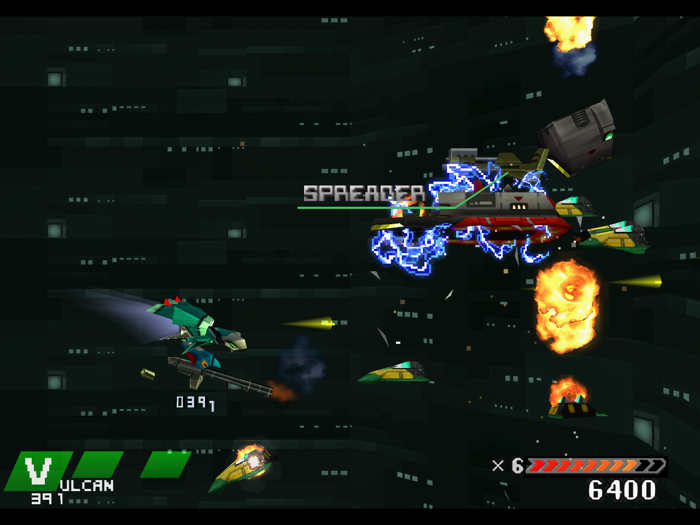
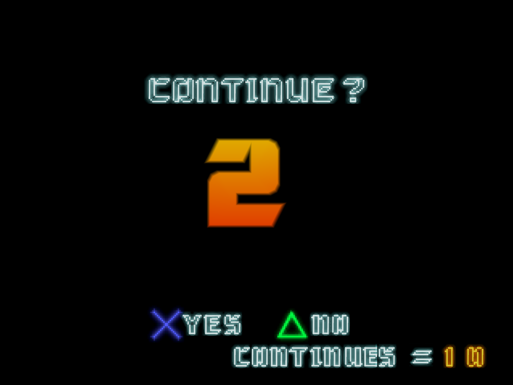
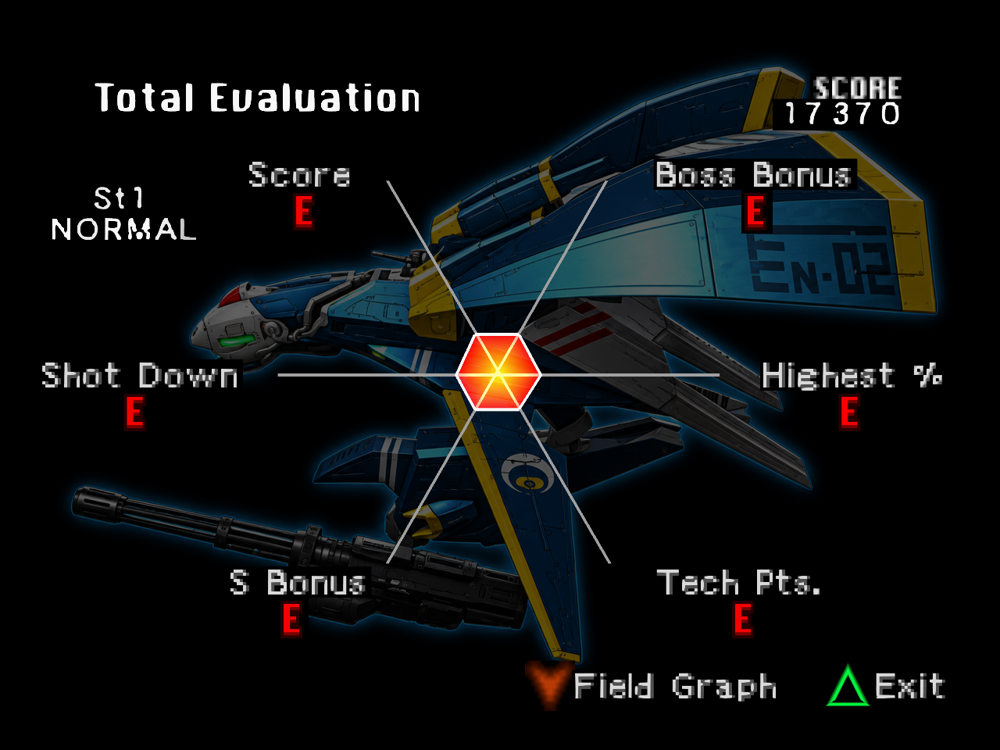

# Stage 1 Wave 2 gameplay results

November 12, 2026. The 723-entry candidate has been exercised in actual gameplay.
**Stage 1 and the full remaster remain incomplete.**

[Play the continuous gameplay excerpt](media/gallery/stage1-wave2-gameplay.mp4).
It shows combat, fire/smoke and the building approach. This is a silent,
1280×960 recording of the owned game window, with one continuous stream-copy
excerpt: no retiming, interpolation, scaling, re-encoding or internal cuts.
The packet hashes and relative timestamps match the source recording.
The earlier [complete facade entry-to-exit video](H24-IN-GAME-RESULTS.md)
remains the evidence for that full fly-past.

The private `frozen-wave2-fx-v1` composition contains 723 authored entries in a
1,559-key pack. It adds the revised sky, office-window atlas, sign/panel polish,
HUD and 65 effects exports. All 219 native exact-region checks passed.
Independent native-texel-centre alpha checks passed for all 65 effects entries;
all 64 checked 1024/2048 fireball, smoke and large-explosion exports also preserve
their v1 alpha planes bit for bit. These checks establish registration and blend
class preservation, not visual quality or complete animation coverage.

The run used automated ordinary controller input with survival assistance off:
no invulnerability, timer aid, RAM writes, state loads, stage jumps, automatic
Continue, rewind or turbo. Native menus preceded enabling the full HD pack, so
this does not accept the new title/selection artwork. Opaque batching, source
capture and video recording were active.

The sampled draw log submitted **375 of 723 authored entries**, including all ten
delivered building tiles, 71 office-atlas palettes, 59 beacon palettes, 13
fireball palettes, nine smoke palettes, the muzzle flash, 31 lamp/panel palettes,
HUD strips and 25 results palettes. The large-explosion family and seven
predicted wordmark uploads were not observed. A submitted draw does not prove
visible pixels, ownership, or every pose, palette and animation phase.

The SPREADER pickup label is readable in the retained 30-second frame. Its
`5C02D3C1-E0C06BFB` source was queried, but no HD submission for that key was
sampled in this run. The authored strip is present in the pack. Because the log
is rate limited, that absence does not establish a runtime admission failure;
wordmark acceptance needs further draw/crop evidence. Fire and
smoke appear in combat, including against the facade approach. Faint class-boundary
outlines remain a review concern; this was a v2 observation, not a matched v1/v2
comparison. Results still contain mixed typography and the known red grade
letters. Those defects remain open.

The revised Mk.II controller lost its remaining lives. Continue was observed at
150 seconds and Total Evaluation at 165 seconds. **Total Evaluation is not a
stage-clear result.** The run closed cleanly with process exit 0 and no harness
errors. The complete observed interval, including terminal screens, averaged
55.55 guest frames/s over 276 seconds, with 962,902 additional output-starved
sample frames. This is not recorder-off pacing or audible-audio acceptance.

The [corrected machine-readable result](media/gallery/stage1-wave2-results-v2.json) retains
the build/composition references, entry-level sampled coverage, controls,
measured deltas, media hashes and contiguous packet proof. The candidate is
private and uninstalled. The original receipt counted only 216 entries because
it compared full source-page keys with registered region keys. Revision 2 checks
the actual composed keys against their input rows; the original receipt remains
available as superseded evidence.

A separate [one-credit Continue check](media/gallery/stage1-continue-results.json)
passed: prompt frames 10384, 10444 and 10504 preceded one six-frame Cross input.
Positive lives and fresh hull geometry were observed before restarting ordinary
controller input. It stopped at the next verified Continue under its one-credit
limit and closed cleanly. This accepts that Continue transition, not stage clear.
The native reference fixtures are included with the regression tests.

A subsequent [v18 wordmark observation](media/gallery/stage1-wordmark-results.json)
positively recorded the SPREADER strip being submitted at 4096×128. Its texture
window mask and offset were zero. The original missing sample must not be
treated as an admission failure. All wordmarks and pickup transitions still
need individual visual acceptance.

Remaining work is tracked in
[completion status](STAGE1-COMPLETION-STATUS.md).
