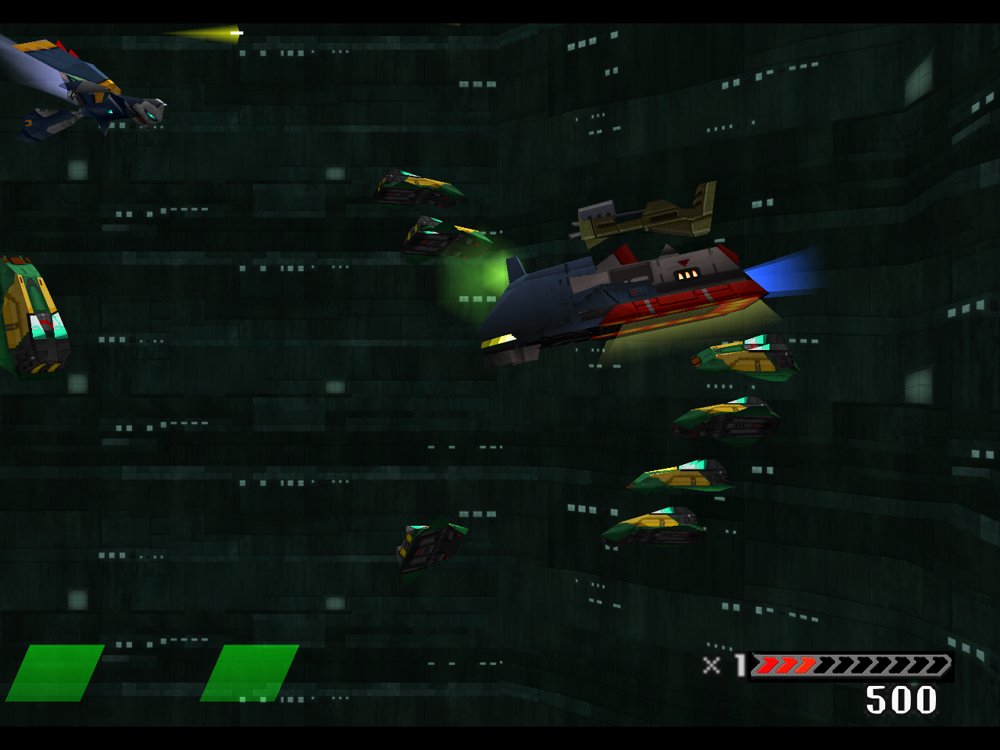

# Wave 3 actual in-game results

November 13, 2026. The private 837-entry composition ran for 180 seconds with
Astraea selected through the native two-slot ARM menu. **This is a component
test; Stage 1 and the full remaster remain incomplete.**

[Play the continuous 34.75-second excerpt](https://github.com/Ghenghis/Einhander-HD/raw/refs/heads/main/docs/media/gallery/stage1-wave3-astraea-gameplay.mp4)
· [Machine-readable results](media/gallery/stage1-wave3-results.json)
· [Remaining completion gates](STAGE1-COMPLETION-STATUS.md)

The pack has 1,669 keys. All 226 native region checks passed. An unsampled,
bounded first-occurrence log positively recorded GL submissions for 448 of the
837 authored entries, including all five new Astraea hull bindings, all 32
canopy phases, and the three canyon wall, emblem and band bindings. This proves
admission for those entries, not acceptance of every pose, palette or material.
The new results/HUD font was not exercised in this gameplay interval.

The controller used finite ordinary pad inputs, firing Cross and Square with
position feedback from completed-frame, source-matched hull geometry. Rewind,
turbo, timer assistance, state loads and RAM writes were off. A single Continue
was allowed by the harness but none was used. Verifying both ARM menus does not
establish equipped-pod or all-weapon coverage; the initial weapon fields are
empty. The final observed lives counter was one. No stage clear was established.

The video is silent, 1280 × 960 H.264. Its 1,886 packets match one contiguous
source sequence; relative timestamps differ by less than three microseconds.
There are no internal cuts, retiming, interpolated frames, scaling or
re-encoding. Thirteen bounded GP0 rings and sequential 2880 × 2160 stills were
also retained privately. These captures are not atomic or a complete replay.

With recording, source collection and diagnostic readbacks active, the complete
interval averaged 49.38 guest frames/s and accumulated 1,496,628 output-starved
sample frames. This is not final pacing/audio acceptance or evidence that the
experimental short-upload scheduling improved performance. That option remains
off by default. Its bounded queue passed 259 CPU checks; the combined runtime
passed 694/696 GL checks with the option both off and on.

Live review found that the canyon windows are too dim under the game's vertex
shading, and the ship is partly clipped by the upper-left policy. Both need
follow-up. Greif v2 failed independent native-centre transparency checks and
was excluded pending correction. Another 157 historical HUD fade aliases lack
actual captured palette bytes. No missing palette was invented.

The preceding 810-second Mk.III stage attempt used five visually verified
Continues and still did not clear the stage. A separate 180-second open-loop
upper-lane test verified one Continue but drifted downward; this run used the
replacement geometry-feedback policy. Neither earlier attempt is a success
claim. Normal-launcher installation, full-stage audio, remaining actors/UI,
later stages and unlock/end states remain open.
