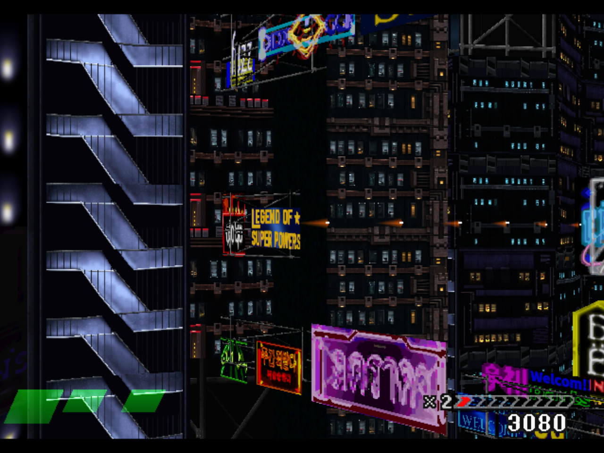
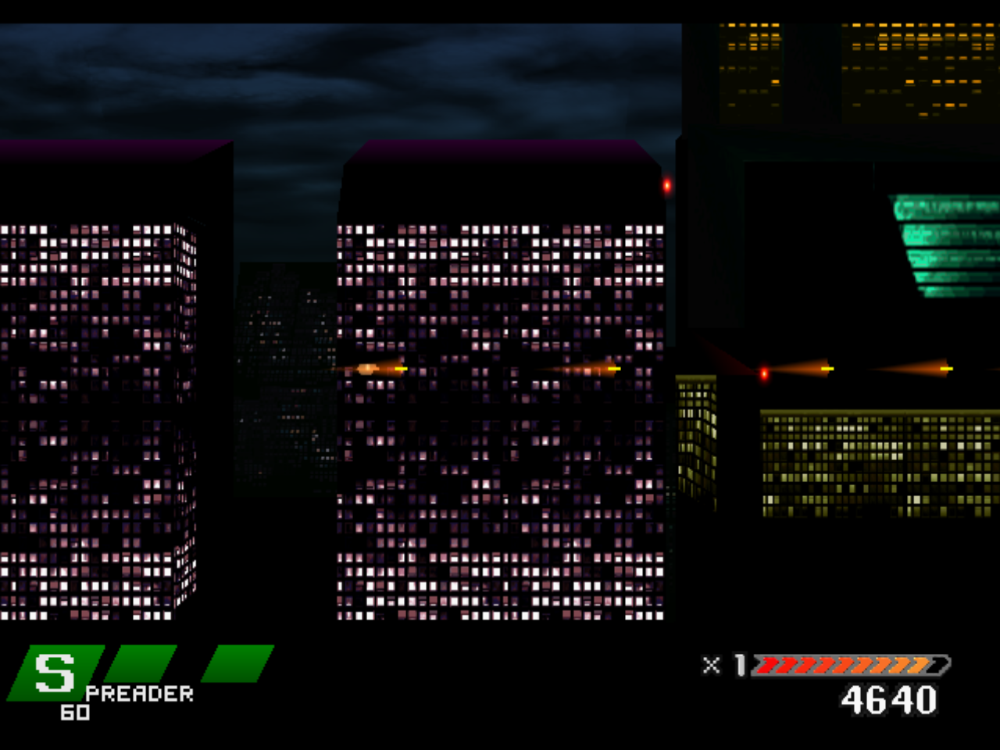

# Actual engine foundation and world integration checkpoint

November 14, 2026. Full remaster completion remains false. The installed runtime and artwork were not replaced. The user's RTX 3090 Ti is reserved for their other project; Einhander and Claude continue CPU-only until explicit GPU return or test authorization. The RTX 3060 project is untouched.

The private [GTE source and test handoff](geometry/v1/HANDOFF.md) preserves 3D view provenance before screen flattening. Its 137 host checks pass, canonical regression harnesses pass on both source versions, and root independently reran all five pinned executables successfully. [Root review](geometry/REVIEW.md) requires independent collection mode, overflow metadata and primitive coverage before integration. This is implemented candidate source, not installed ray tracing or DLSS. The installed Remix SDK API-table initialization is separately qualified; renderer startup, gameplay scene capture and the complete backend remain unfinished.

The private world composition has 1,698 keys after 161 patches (29 additions and 132 replacements), retaining all five crisp sign overrides. Native loader admission passed 1,698 keys and 226 exact regions with zero failures. Independent categorical-alpha checks covered 5,154,816 native texel centres across 161 entries with zero mismatches. Parent files remain hash-identical. The plan targets all 21 sampled absent keys and 114 of 126 sampled legacy keys with unused artwork; the remaining 12 and distant window authoring stay explicit gaps. This does not establish a full-game denominator or accepted visual fidelity.

The actual 120-second private game review uploaded 140 changed keys. It produced 7,191 valid frame pairs: median 16.6665 ms, p99 18.4895 ms, maximum 93.2445 ms, six over 50 ms and none over 100 ms. **Audio acceptance failed: 3,351 newly starved samples**, all in the first sampled second (approximately 0.03–1.00 s), with zero new overflow drops. Later sampled intervals added no starvation. Five synchronous native/composed still pairs, no focused samples and permitted light CPU work prevent a controlled comparison or causal pack-regression claim. Uploads do not prove per-key draw submissions. The source screenshots are 1280x960, retain coarse signs/soft windows and do not satisfy the requested realistic 4K fidelity. No video, source collector or listening acceptance ran. Countdown-byte-only bounded assistance is disclosed; no stage/lives writes or state loads occurred. Exit 0, closed port, absent owned PID and reservation release were verified.

The [live summary](world/world-integration-live-results.json), [audio onset](world/world-audio-onset.json), [native admission](world/verification.json), [selected raw observations](world/selected-proof.json), source hashes and original execution receipts are retained. Replaying the published frame analyzer against selected-proof.json reproduces the phase result. Full texture/native input packs, original full candidate JSON, original complete command journal, PCM and binaries stay local; hashes identify them. Local-source scripts keep their original C: prerequisites and are not self-contained build/recovery instructions.
